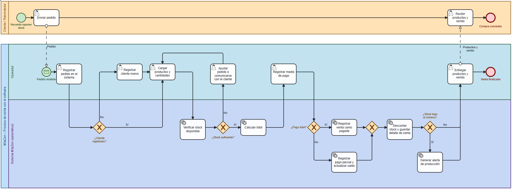

# MilaZen-Gestion

Programa administrativo para el emprendimiento MilaZen.
Trabajo Práctico Integrador – Organización Empresarial – Tecnicatura Universitaria en Programación a Distancia (UTN).

## Integrante

- **Roberto Teodosio**

## Descripción del sistema

MilaZen es un microemprendimiento de Río Cuarto que fabrica y vende por mayor milanesas y empanadas veganas congeladas. Hoy la administración se hace con una planilla de Excel por mes y un cuaderno, lo que dificulta comparar períodos, actualizar costos y precios a mitad de mes y conocer la rentabilidad.

El sistema propuesto es un programa de gestión, usable desde la computadora y desde el celular, que integra:

- **Productos y recetas:** precios y costos que se pueden cambiar sin alterar resultados pasados.
- **Compras, gastos y proveedores.**
- **Stock y producción:** con alertas de faltante o sobreproducción.
- **Ventas y clientes:** medios de pago y saldos pendientes.
- **Reportes de rentabilidad.**

## Proceso de negocio (BPMN)

Se modeló el proceso que el sistema automatiza: el registro de una venta a un revendedor. Participan el cliente (actor externo), el propietario y el sistema. Las decisiones del proceso son: si el cliente está registrado, si hay stock suficiente, si el pago es total o parcial y si el stock queda por debajo del mínimo.

[Editable BPMN del proceso de venta](docs/BPMN_venta.bpmn)

## Diccionario de datos

Este apartado fue agregado con intencion de practicar el armado de tablas en archivos .md y agregar mas informacion del programa.

El diccionario de datos está en [docs/diccionario_de_datos.md](docs/diccionario_de_datos.md)

## Historias de usuario

Las historias de usuario están en [docs/historias_de_usuario.md](docs/historias_de_usuario.md).

Tablero del proyecto: https://github.com/users/rok3nrL/projects/1/views/1

## Indicadores de control

## Indicadores del sistema (auditoría técnica)

| Indicador | Cómo se mide | Estándar |
|---|---|---|
| Tiempo de registro de una venta habitual | Promedio de cronometrar 5 ventas de prueba | 60 segundos o menos |
| Productos gestionados | Productos cargados y operativos en el sistema | 8 de 8 |
| Registros mensuales soportados | Compras y ventas cargadas en un mes de prueba sin fallas | 200 o más |
| Acceso desde el celular | Dispositivos móviles que cargan y consultan datos | 2 de 2 |
| Exactitud del stock | Diferencia entre el stock del sistema y el conteo físico | 2 % o menos |
| Saldos de clientes correctos | Casos de prueba de ventas con pago parcial calculados bien | 100 % |

## Indicadores del proyecto

| Indicador | Cómo se mide | Estándar |
|---|---|---|
| Cumplimiento del cronograma | Etapas del Gantt terminadas en la semana prevista | 5 de 5 |
| Historias de usuario terminadas | Tarjetas en la columna Done del tablero | 3 de 3 |

## Declaración de Uso de IA

Se usó **Claude** como asistente para organizar la Entrega 4, principalmente ayudo a comprender conceptos y uso de distintas herramientas como BPMN.io y Git-Hub. Fue muy util para darme nocion de como se arman un README.md mas profesional usando "#" y tablas.  
Tambien me ayudo a corregir redacción y ortografía de manera muy agil.

**Prompts utilizados**

1. Le pasé la consigna de la Entrega 4, y que me ayudara a pensar los pasos del proceso de venta para hacer el diagrama BPMN y donde hacerlo.
2. Le pedí ayuda para redactar un README.md profesional guiandose por mi trabajo realziado hasta el TP nº 3.
3. Le pedi que me ayudara con el uso de Git-Hub y Git usando comandos por consola.
4. Le pedi que corrijiera errores ortograficos y aconsejara en una redaccion profesional.

**Correcciones que hice yo sobre lo que generó la IA:**

- Se le pidio varias veces que explicara el funcionamiento de algunas herramientas para realmente entenderlas en la practica.
- Se borraron muchas cosas inesesarias y otras que si eran utiles se simplificaron, esto fue asi tanto en etapas del proceso de ventas como en el README propuesto.
- Se fue corroborando paso a paso la guia en el uso de git y aprendiendo en el proceso.

## Revisión de pares

Se recurrio a la autorevision en los procesos de Pull Request y no por parte de un compañero ya que este trabajo fue realizado por una sola persona.
[Link](https://github.com/rok3nrL/MilaZen-Gestion/pull/1) de acceso a GitHub de uno de los Pull Request ya realizados.
